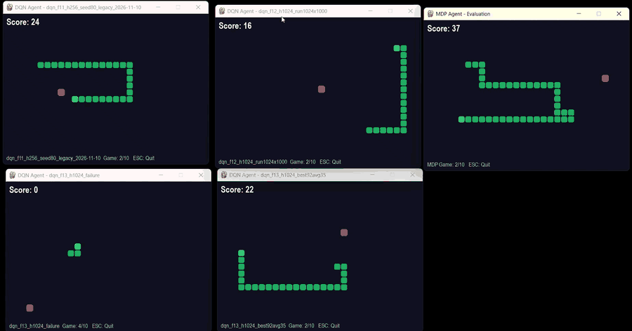

# AI-801-group-5-snake-agent

mdp stuff first

## Evaluation Results



Every agent plays the same games (seed 42). Scores are the number of food items eaten.

| Agent | 10 games<br>avg / median / best | 100 games<br>avg / median / best | 1000 games<br>avg / median / best |
|---|---|---|---|
| DQN `f13_h1024_best92avg35` | **36.2** / 35.5 / 53 | **36.61** / 36 / 61 | **35.76** / 36 / 82 |
| MDP agent | 33.0 / 30.5 / 52 | 32.80 / 32 / 64 | 34.60 / 33 / 84 |
| DQN `f12_h1024_run1024x1000` | 31.3 / 34.5 / 42 | 32.11 / 32 / 64 | 31.61 / 31.5 / 64 |
| DQN `f11_h256_seed80_legacy` | 31.9 / 31 / 47 | 28.93 / 28 / 54 | 29.31 / 29 / 63 |
| DQN `f13_h1024_failure` | 0.0 / 0 / 0 | 0.02 / 0 / 1 | 0.04 / 0 / 2 |

Model names: `f` = input features, `h` = hidden units. The `failure` model is kept to show a training run that collapsed.

Per-game results: [10 games](finalResults/evaluations/games_10/), [100 games](finalResults/evaluations/games_100/), [1000 games](finalResults/evaluations/games_1000/).

## Final results

These folders are inside `finalResults/`:

- `models/` contains the four saved DQN checkpoints.
- `training/` contains the training history for each checkpoint, with the same name.
- `evaluations/` contains per-game CSV files for each run.
- `archive/` keeps duplicate checkpoint copies and older results.
- `Eval.ipynb` is the original evaluation notebook.

# Snake AI Project — Commands

## 1. MDP Reward Agent

### Change to MDP folder

```powershell
cd D:\projects\pythonProjects\PythonProject\MDP_Reward
```

### Watch MDP play

```powershell
# Normal game (8 FPS)
python main.py
```

### Evaluate MDP and record results

```powershell
# Watch 10 games (default: 30 FPS)
python evaluate.py --games 10

# Watch 100 games
python evaluate.py --games 100

# Watch 100 games using seed 42
python evaluate.py --games 100 --seed 42

# Watch at 8 FPS (same as main.py)
python evaluate.py --games 100 --seed 42 --fps 8

# Watch at 30 FPS
python evaluate.py --games 100 --seed 42 --fps 30

# Watch at 60 FPS
python evaluate.py --games 100 --seed 42 --fps 60

# Evaluate 500 games
python evaluate.py --games 500 --seed 42

# Evaluate 1000 games without graphics
python evaluate.py --games 1000 --seed 42 --no-display
```

### MDP Output File

- `results/mdp_evaluation.csv` — evaluation results

---

## 2. Deep Q-Learning (DQN) Agent

### Change to DQN folder

```powershell
cd D:\projects\pythonProjects\PythonProject\dqagent
```

### Install dependencies

```powershell
python -m pip install -r requirements.txt
```

### Train DQN

```powershell
# Quick test: 10 episodes
python train.py --episodes 10

# Train for 100 episodes
python train.py --episodes 100

# Train for 2000 episodes
python train.py --episodes 2000

# Train for 5000 episodes
python train.py --episodes 5000

# Train using seed 42
python train.py --episodes 2000 --seed 42

# Train and save results to a different CSV
python train.py --episodes 2000 --log results/2000_episodes.csv
```

### Watch DQN play

```powershell
# Watch trained agent (8 FPS)
python main.py

# Watch untrained agent (8 FPS)
python main.py --untrained
```

### Evaluate DQN and record results

```powershell
# Watch 10 games (default: 30 FPS)
python evaluate.py --games 10

# Watch 100 games
python evaluate.py --games 100

# Watch 100 games using seed 42
python evaluate.py --games 100 --seed 42

# Watch at 8 FPS (same as main.py)
python evaluate.py --games 100 --seed 42 --fps 8

# Watch at 30 FPS
python evaluate.py --games 100 --seed 42 --fps 30

# Watch at 60 FPS
python evaluate.py --games 100 --seed 42 --fps 60

# Evaluate 500 games
python evaluate.py --games 500 --seed 42

# Evaluate 1000 games without graphics
python evaluate.py --games 1000 --seed 42 --no-display
```

### Completed DQN Results

- `finalResults/models/` — saved checkpoints for the completed training runs
- `finalResults/training/` — their training histories
- `finalResults/evaluations/` — evaluation CSV files, reports, and graphs

The existing training commands above are kept for reference. Training code was not changed during this results cleanup.

---

## 3. Recommended Comparison Workflow

### Step 1 — Evaluate MDP

```powershell
cd D:\projects\pythonProjects\PythonProject\MDP_Reward
python evaluate.py --games 100 --seed 42 --fps 30
```

### Step 2 — Train DQN

```powershell
cd D:\projects\pythonProjects\PythonProject\dqagent
python train.py --episodes 2000 --seed 42
```

### Step 3 — Evaluate DQN

```powershell
python evaluate.py --games 100 --seed 42 --fps 30
```

---
## Compare the saved DQN models

Training is complete. From the project folder, run this to evaluate every checkpoint in `finalResults/models` on the same games:

```powershell
# Watch the games (default: 30 FPS)
python scripts\evaluate_all.py --games 10 --seed 42 --fps 20

# Evaluate 1000 games without graphics
python scripts\evaluate_all.py --games 1000 --seed 42 --no-display
```

Each run is saved under `finalResults/evaluations`. Each model gets an `evaluation_<model-name>.csv` file, named from its checkpoint, with one row per game. Increase `--games` for a steadier comparison.
